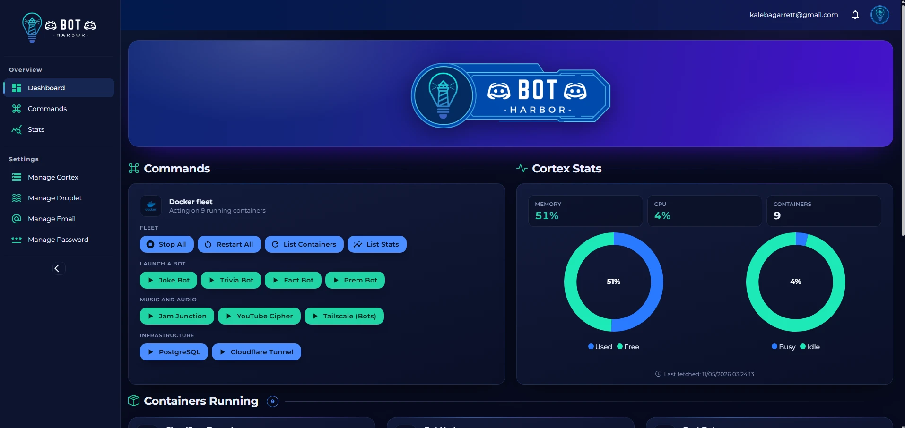

# Bot Dashboard

A personal project for managing my Discord bots through a web-based dashboard. The dashboard is built using Blazor and .NET 8, with a modern UI powered by MudBlazor. It also utilizes SSH.NET for secure server communications.

## Features

- **Real-time Monitoring:** Keep track of my bots' status and activities.
- **Command Execution:** Execute Ubuntu and Docker commands directly from the dashboard.
- **Customizable UI:** Utilizes MudBlazor for a sleek and responsive interface.

## Technologies Used
| Name | Description |
| ------------- | ------------- |
| **[.NET 8](https://dotnet.microsoft.com/en-us/download/dotnet/8.0)** | Provides a robust and high-performance backend. |
| **[Blazor](https://github.com/dotnet/blazor)** | For building the interactive web UI. |
| **[MudBlazor](https://github.com/MudBlazor/MudBlazor)** | A Material Design component library for Blazor. |
| **[PostgreSQL](https://www.postgresql.org/)** | Stores the operator account. Runs in a container on the NAS. |
| **[Tailscale](https://tailscale.com/)** | Private tunnel to the dashboard. No port forward, nothing public. |
| **[SSH.NET](https://github.com/sshnet/SSH.NET)** | Enables secure SSH operations with remote servers. |

## Hosting

The dashboard is **self-hosted on Cortex**, a UGREEN DXP4800 Plus NAS, as a three-container
Docker Compose stack. It used to run as an Azure App Service with an Azure SQL database; both
are gone, along with the bill.

```text
Browser on the tailnet ──HTTPS──▶ bot-harbor.<tailnet>.ts.net
                                      │ tailscale serve
                                      ▼
                                  botharbor-app ──▶ botharbor-postgres
                                      │
                                      └──SSH / DO API──▶ droplet running the bots
```

The bots themselves are unchanged — they still run on the DigitalOcean droplet. Only the
dashboard and its database moved home.

**[Setup, operations and troubleshooting → `deploy/README.md`](deploy/README.md)**

Quick start on the NAS:

```bash
cp .env.example .env   # fill in the blanks
docker compose up -d
```

Local development needs only the database. The dev overlay publishes it on loopback, which
the NAS deliberately does not do:

```bash
docker compose -f docker-compose.yml -f docker-compose.dev.yml up -d postgres
dotnet run --project BotDashboard.App
```

## Digital Ocean

**Host Your Own Bots:**
   ```plaintext
   https://www.digitalocean.com
   ```

## Stats


## Screenshots

